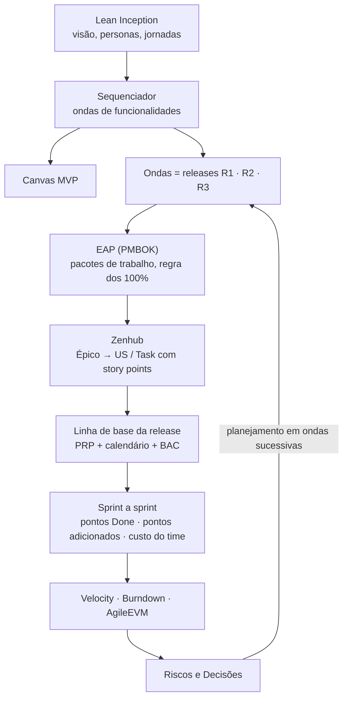

# Modelo de gestão

Esta página define **o que cada número do Dashboard Analítico representa, de onde
ele vem e quem o mantém**. Ela existe porque um indicador só serve para decidir
se a equipe concorda sobre o que ele mede. Sem esse acordo, a velocity e o EVM
viram gráficos, e não instrumentos de gestão.

## 1. A cadeia de rastreabilidade

- **Lean Inception** diz *o que* entra no produto e em que ordem. O sequenciador
  fatia as funcionalidades em ondas, e cada onda vira uma release.
- **PMBOK** transforma as ondas em escopo gerenciável. A EAP garante que nada
  fique de fora (regra dos 100%). O que ainda não pode ser decomposto fica como
  pacote de planejamento (ondas sucessivas).
- **Scrum** transforma escopo em compromisso por sprint: US e Tasks estimadas
  em story points e aceitas pelo PO.
- **AgileEVM** mede o desempenho contra a linha de base: estamos entregando o
  escopo no ritmo planejado (SPI) e ao custo planejado (CPI)?

## 2. Decisões que fixam as regras

| Decisão | Valor adotado | Por quê |
| --- | --- | --- |
| Calendário oficial | O do **Zenhub**: S1 24/08–06/09, S2 07/09–20/09, semanais a partir de 21/09 | É o único que fecha exatamente nas datas das releases (27/09, 25/10, 29/11). A planilha quinzenal anterior terminava a R1 em 04/10. |
| Sprints por release (L) | R1 = 3 · R2 = 4 · R3 = 5 | Consequência do calendário. |
| Critério de "feito" | Issue **fechada** | Para os story points serem contabilizados a issue só precisa estar fechada, em qualquer pipeline. Issue aberta (inclusive no Done) não conta. |
| O que recebe story points | **Só a US (Feature) aceita pelo PO.** Task, Sub-task e Bug não pontuam. | Feedback da R2 (ação C1.2): Velocity, SPI e CPI medem valor funcional aceito. O trabalho técnico e os defeitos são acompanhados pelas métricas de fluxo (Throughput, Lead Time, Cycle Time), sem alterar o EVM. Ver D4 em [Decisões](/docs/planejamento/decisoes). |
| Custo | Custo do time: integrantes ativos na semana × custo de um integrante por semana + infraestrutura (aba Planejamento) | Como na literatura de EVM ágil (Sulaiman et al., 2006), ninguém aponta horas: o custo é o do time. |

## 3. O que cada informação representa

### Parâmetros (`config.PARAMETROS`)

Regras do time lidas pelo dashboard (não é aba da planilha: muda só por decisão).

| Campo | Significado |
| --- | --- |
| `niveis_pontuados` (feito = issue fechada, fixo no código) | As regras da seção 2. |
| `janela_planning_horas` | O planejado de cada sprint é o escopo ao fim deste prazo após o início (a planning). |
| `min_sprints_media_velocity` | Sprints concluídas necessárias para mostrar a velocity média. |
| `sprints_canceladas` | Ids de sprints do Zenhub que ficam fora da média. |

### Calendário (Zenhub)

Datas e situação das sprints vêm do Zenhub. A release de cada sprint é a Release
do Zenhub que contém as issues dela; sem Release cadastrada, vale a data de
entrega do plano de ensino (R1 28/09, R2 26/10, R3 30/11). `n` é a posição da
sprint na release e `L` o total de sprints dela.

### Zenhub (`data/zenhub/velocity/*.json`)

Snapshot gerado por `scripts/coleta_velocity.py` (regras em
[Velocity pela API do Zenhub](https://github.com/fga-eps-mds/2026.2-MeasureSoftGram-DOC/blob/main/Analytics/docs/velocity-zenhub.md)). Dele saem:

| Sigla | Nome | Definição |
| --- | --- | --- |
| PP | Pontos planejados | Pontos das issues pontuáveis na sprint ao fim da planning. |
| PC | Points Completed | Pontos das issues concluídas dentro da sprint. |
| PRP | Planned Release Points | Pontos das issues que passaram pelas sprints da release, cada uma uma vez. Linha de base = PP da 1ª sprint, **congelado** na coleta seguinte à planning. |
| PA | Points Added | Quanto o PRP cresceu na sprint. |
| RPC | Release Points Completed | Pontos do PRP já concluídos. |

### Planilha (só o que o Zenhub não tem)

Abas **Custos** (custo/hora), **Planejamento** (quem está ativo em cada semana),
**Horas**, **Riscos**, **Monitoramento** e **Decisões**.

### AgileEVM

Sulaiman, Barton e Blackburn (2006), calculado por release:

| Sigla | Fórmula | Leitura |
| --- | --- | --- |
| PPC | n / L | Quanto da release *deveria* estar pronto. |
| APC | RPC / PRP | Quanto da release *está* pronto. |
| BAC | custo planejado das semanas da release (aba Planejamento) | Orçamento da release. |
| PV | PPC × BAC | Valor planejado até aqui. |
| EV | APC × BAC | Valor agregado até aqui. |
| AC | Σ custo do time nas sprints iniciadas (sem custo na aba Planejamento: **indisponível**, junto com CPI, CV, ETC e EAC) | Custo real até aqui. |
| SPI | EV / PV = APC / PPC | Abaixo de 1 significa atraso. |
| CPI | EV / AC | Abaixo de 1 significa gastar mais do que se entrega. |
| SV, CV | EV − PV, EV − AC | Variâncias em valor. |
| ETC, EAC | (BAC − EV) / CPI, AC + ETC | Projeção de custo final. |
| RD | início + duração / SPI | Quando a release fecha, no ritmo atual. |

### Métricas de fluxo (página Fluxo)

Task, Sub-task, Bug e issue sem tipo não pontuam. Elas são acompanhadas em itens e dias, sem story
points e sem alterar o EVM (Kanban; ata da R2, ação C1.4):

| Métrica | Fórmula | Leitura |
| --- | --- | --- |
| Throughput | issues fechadas por semana (segunda a domingo, Brasília) | Ritmo de conclusão do trabalho técnico. |
| Lead Time | fechamento − criação, em dias (mediana e percentil 85) | Quanto uma issue leva para ser entregue. |
| Cycle Time | fechamento − entrada em *In Progress* | **Indisponível**: a coleta guarda só a última transferência de pipeline. |
| Taxa de conclusão | fechadas ÷ ativas no período | Q-Rapids, *Development Task Completion*. |

Para habilitar o Cycle Time é preciso coletar o histórico de transferências de pipeline
(`Issue.timelineItems` da API do Zenhub), validando a query com `scripts/diagnostico_zenhub.py`.

### Riscos (aba Riscos)

Registro de riscos do PMBOK. Os campos são: **categoria**, **risco**, **gatilho**
(o sinal observável de que ele está ocorrendo), **probabilidade** e **impacto**
(escala de 1 a 5, com exposição = P × I de 1 a 25; ver [Plano de Riscos](/docs/planejamento/riscos)), **resposta** (Evitar, Mitigar,
Transferir ou Aceitar), **plano de resposta**, **responsável**, **status** e
**última revisão**. Um risco sem responsável não tem resposta. O registro é
revisado em toda retrospectiva.

### Decisões (aba Decisões)

Fecha o ciclo: *métrica → causa → decisão → resultado*. É a evidência de gestão
baseada em dados, e a R2 cobra ≥ 3 registros, a R3 ≥ 5.

## 4. O que a R1 mostra

A R1 **não tem linha de base declarada**. As sprints 1 e 2 foram de diagnóstico,
migração de repositórios e Lean Inception, sem pontos. O sequenciador não fechou,
um risco já materializado (R10). Por isso o dashboard **reconstitui** o PRP da R1
a partir do histórico de escopo do Zenhub e declara isso na tela.

A contribuição da DA-R1 é estabelecer o modelo, expor a qualidade do dado do
quadro e congelar a linha de base da R2 na planning de 28/09.

## 5. Rotina de atualização

| Quando | O quê | Quem |
| --- | --- | --- |
| Planning de abertura da release | Garantir as issues da release no Zenhub (a linha de base congela sozinha) | Líderes da quinzena |
| Toda segunda (planning) | Atualizar os integrantes ativos da semana na aba Planejamento | Líderes da quinzena |
| Fim de cada sprint | Fechar as issues entregues (a coleta diária do workflow atualiza o painel) | Líderes da quinzena |
| Toda retrospectiva | Revisar riscos e registrar decisões | Equipe |

## Referências

- SULAIMAN, T.; BARTON, B.; BLACKBURN, T. **AgileEVM: Earned Value Management in Scrum Projects**. Agile Conference, 2006.
- PMI. *PMBOK Guide*: gerenciamento de escopo, cronograma, custos e riscos.
- CAROLI, P. **Lean Inception**.
- SCHWABER, K.; SUTHERLAND, J. **Guia do Scrum**.

## Histórico de versão

| Versão | Data | Descrição | Autor | Revisor |
| --- | --- | --- | --- | --- |
| 1.0 | 27/09/2026 | Modelo de gestão e dicionário de dados do DA-R1 | [@MilenaFRocha](https://github.com/MilenaFRocha) |  |
| 1.1 | 21/10/2026 | Padronização: título, caixas de aviso e histórico; correções de consistência | [@MilenaFRocha](https://github.com/MilenaFRocha) |  |
| 1.2 | 06/11/2026 | Só US pontua; AC é o custo do time, sem horas; métricas de fluxo (DA-R3.02) | [@zzzBECK](https://github.com/zzzBECK) |  |
