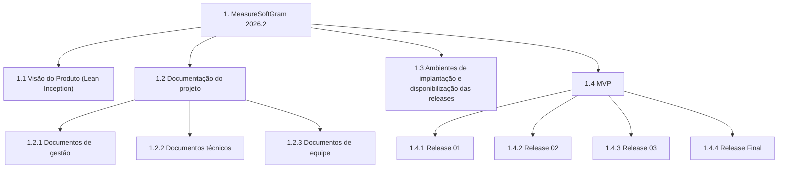

# Estrutura Analítica do Projeto (EAP)

## 1. Objetivo do documento

A **Estrutura Analítica do Projeto** (EAP, ou *Work Breakdown Structure*) é a
decomposição hierárquica de todo o trabalho a ser executado pela equipe para
entregar o produto. Ela não é um cronograma nem uma lista de tarefas: é o
inventário do **escopo**, organizado de forma que se possa verificar se algo
ficou de fora.

Neste projeto a EAP cumpre duas funções concretas:

1. É a origem da rastreabilidade exigida pela disciplina — as issues e
   sub-issues no ZenHub refletem seus pacotes de trabalho, pelo código numérico.
2. É o insumo da alocação: as funcionalidades de cada release do MVP definem a
   composição dos [squads por release](/docs/planejamento/squads).

## 2. Regras de construção adotadas

Três regras guiaram esta versão, e vale registrá-las porque elas explicam
escolhas que de outra forma pareceriam arbitrárias.

**Regra dos 100%.** A EAP contém todo o escopo do projeto, e nada além dele. Se um
trabalho não está aqui, ele não está no projeto.

**Pacotes são entregas, não atividades.** Cada pacote de trabalho é nomeado por
aquilo que existe ao final dele, não pela ação de produzi-lo. "Quadro de
conhecimento e pareamentos" tem critério de conclusão verificável; "conhecer o
time" não tem.

**Decomposição orientada a entregas.** A primeira versão desta EAP seguia as fases
do ciclo de vida (iniciação, planejamento, execução e encerramento) e mantinha as
funcionalidades do MVP como pacotes de planejamento, porque o sequenciador da Lean
Inception ainda não havia fechado. Com o sequenciador concluído em 26–27/09, a EAP
foi reorganizada em quatro grupos de entrega — visão do produto, documentação,
ambientes e MVP — e as funcionalidades de cada release passaram a ser pacotes de
trabalho nomeados.

## 3. Artefato visual

O quadro abaixo, no FigJam, é a fonte da EAP. As seções seguintes o transcrevem e
descrevem cada pacote.

<iframe
  style={{border: '1px solid rgba(0, 0, 0, 0.1)'}}
  width="100%"
  height="450"
  src="https://embed.figma.com/board/ysIVNgOkVcb1pVouEfB5Pp/EAP---ATUALIZADA?node-id=0-1&embed-host=share"
  allowFullScreen
></iframe>

## 4. Visão geral



## 5. Decomposição

### 1.1 Visão do Produto (Lean Inception)

**Objetivo do grupo:** definir o produto a ser construído e o plano para
entregá-lo — backlog, cronograma, protótipos e identidade visual derivados da
[Lean Inception](/docs/lean-inception/visao-geral).

| Código | Pacote de trabalho | Descrição |
|:---:|:---|:---|
| 1.1.1 | Backlog do Produto | Épicos e histórias de usuário com critérios de aceitação, estimados e priorizados com o PO. |
| 1.1.2 | Cronograma e planejamento de releases | Marcos das releases major e minor, calendário de sprints e roadmap no ZenHub. |
| 1.1.3 | Protótipos de alta fidelidade | Protótipos no Figma das funcionalidades priorizadas, validados com o cliente. Exigidos na R1 e evoluídos na R2. |
| 1.1.4 | Identidade visual | Guia de identidade visual do produto e da documentação. |

### 1.2 Documentação do projeto

**Objetivo do grupo:** produzir os documentos que governam o projeto, descrevem o
produto e organizam a equipe, do início ao encerramento do semestre.

#### 1.2.1 Documentos de gestão

| Código | Pacote de trabalho | Descrição |
|:---:|:---|:---|
| 1.2.1.1 | Registro do projeto e do parceiro | Projeto escolhido, organização parceira, Product Owner e o problema que o produto resolve, registrados na documentação. |
| 1.2.1.2 | EAP | Este documento: decomposição do escopo e sua manutenção ao longo do semestre. |
| 1.2.1.3 | Planilha de custos e EVM-Ágil | Modelo de custo, linha de base e cálculo de CPI, SPI e EAC a partir de horas reais individuais. |
| 1.2.1.4 | Análise planejado × realizado | Comparação em custo (EVM), tempo, escopo e qualidade, com análise das causas dos desvios. |
| 1.2.1.5 | Matriz de riscos | Riscos com probabilidade, impacto, resposta e responsável, revisada a cada sprint. |
| 1.2.1.6 | Relatório de Encerramento | Relatório final, com a seção obrigatória *"Como usamos IA neste semestre"*. |

#### 1.2.2 Documentos técnicos

| Código | Pacote de trabalho | Descrição |
|:---:|:---|:---|
| 1.2.2.1 | Diagnóstico do ecossistema herdado | Avaliação técnica dos repositórios de 2026.1 e o [backlog técnico](/docs/diagnostico/backlog-tecnico) dela derivado. |
| 1.2.2.2 | Documento de Arquitetura | Arquitetura herdada e planejada, diagramas de componentes, implantação e entidade-relacionamento, e as decisões arquiteturais (ADRs). |
| 1.2.2.3 | Fluxo de Trabalho | [Fluxo de trabalho](/docs/processo/fluxo-de-trabalho) da equipe: do item no backlog ao merge, com branches, revisão e templates de issue e Pull Request. |
| 1.2.2.4 | Gerência de configuração consolidada | Política de branching aplicada, merges, releases com tags e conformidade com padrões de software livre. |
| 1.2.2.5 | Avaliação final da qualidade | Avaliação do produto à luz do modelo de qualidade adotado, com o histórico de evolução das métricas. |
| 1.2.2.6 | Manual de instalação do produto | Guia de instalação e uso destinado ao usuário final. |

#### 1.2.3 Documentos de equipe

| Código | Pacote de trabalho | Descrição |
|:---:|:---|:---|
| 1.2.3.1 | Plano de comunicação e rodízio de lideranças | Cerimônias com horário, formato e canal; calendário do rodízio quinzenal das lideranças de projeto, processo e produto; papéis de cada integrante. |
| 1.2.3.2 | Quadro de conhecimento e pareamentos | Matriz integrante × repositório, âncoras por repositório e regra de pareamento de entrada. Exigido na R1. |
| 1.2.3.3 | Retrospectiva crítica do uso de IA | O que a IA acertou, o que errou e onde o julgamento humano foi indispensável ao longo do semestre. |

### 1.3 Ambientes de implantação e disponibilização das releases

**Objetivo do grupo:** garantir que cada release seja construída, verificada e
publicada de forma reproduzível, a partir de repositórios que funcionam em
conjunto.

| Código | Pacote de trabalho | Descrição |
|:---:|:---|:---|
| 1.3.1 | Repositórios migrados e configurados | Merge de 2026.1 no repositório central e fork para 2026.2, um por componente, com licença, código de conduta e guia de contribuição. |
| 1.3.2 | Pipeline CI/CD | Pipeline com lint, build, testes e relatório SonarCloud nos repositórios, com portões de qualidade bloqueantes. |
| 1.3.3 | Repositórios integrados via Platform | Repositório Platform que reúne os componentes como submódulos e sobe a stack completa com um único comando, para desenvolvimento e implantação. |

### 1.4 MVP

**Objetivo do grupo:** entregar as funcionalidades do MVP definidas pelo
[sequenciador da Lean Inception](/docs/lean-inception/sequenciador), uma release
por vez, implantadas e validadas com o cliente. O detalhamento em épicos e
histórias está no [Roadmap](/docs/planejamento/roadmap#ondas-de-escopo).

#### 1.4.1 Release 01

| Código | Pacote de trabalho | Descrição |
|:---:|:---|:---|
| 1.4.1.1 | Medida de dívida técnica [MSG01] | Operacionalização da medida de dívida técnica no modelo de qualidade, calculada pelo Core e exibida no produto. |
| 1.4.1.2 | Desempenho do carregamento do frontend | Correção do fluxo de carregamento do frontend, com ganho medido no tempo de carregamento das telas. |

#### 1.4.2 Release 02

| Código | Pacote de trabalho | Descrição |
|:---:|:---|:---|
| 1.4.2.1 | Gráfico de pulso | Gráfico que mostra a variação da qualidade do repositório ao longo do tempo. |
| 1.4.2.2 | Rastreabilidade entre arquivos e métricas | Rastreabilidade dos arquivos de código-fonte entre métricas e medidas: a partir de uma medida, chegar aos arquivos que a compõem. |
| 1.4.2.3 | Autenticação de usuários pelo GitLab | Login no produto com conta do GitLab. |
| 1.4.2.4 | Importador de repositórios GitLab | Importação de repositórios do GitLab para análise, como já ocorre com os do GitHub. |
| 1.4.2.5 | Novos gráficos do dashboard | Novas visualizações das características, subcaracterísticas e medidas no dashboard. |
| 1.4.2.6 | Gráfico planejado × realizado do equalizador | Comparação entre a meta de qualidade configurada no equalizador e a qualidade efetivamente medida. |
| 1.4.2.7 | Adequação à LGPD | Correção do tratamento de dados pessoais para conformidade com a LGPD. |
| 1.4.2.8 | Dashboard nativo (substituto do Grafana) | Gráficos nativos do Front alimentados pela API do Service, em substituição aos iframes do Grafana. |

#### 1.4.3 Release 03

| Código | Pacote de trabalho | Descrição |
|:---:|:---|:---|
| 1.4.3.1 | Característica de segurança | Inclusão da característica de segurança no modelo de qualidade, com suas subcaracterísticas e medidas. |
| 1.4.3.2 | Alerta de decaimento antes do merge | Aviso no Pull Request quando a mudança reduz a qualidade do repositório, antes do merge. |
| 1.4.3.3 | Pesos das entidades por AHP | Definição dos pesos das entidades de qualidade pelo método AHP (*Analytic Hierarchy Process*). |
| 1.4.3.4 | Pipeline GitLab CI/CD | Integração do MeasureSoftGram ao GitLab CI/CD, análoga à Action do GitHub, para usuários do produto que hospedam código no GitLab. |

#### 1.4.4 Release Final

| Código | Pacote de trabalho | Descrição |
|:---:|:---|:---|
| 1.4.4.1 | Reforço de segurança do produto | Revisão e correção de vulnerabilidades antes da entrega final. |

## 6. Divergências em aberto

:::caution[A resolver com a equipe]
- **Regra dos 100%.** Itens cobrados nos critérios das releases não aparecem no
  quadro: suíte de testes e metas de cobertura (≥ 85% e ≥ 90%), Dashboard
  Analítico (DA-R1 a DA-R3 e Canvas Analytics), testes de aceitação com o
  cliente, ambiente de homologação, coleta automatizada do `.json` de métricas e
  ambientes de trabalho (GitHub, ZenHub, SonarCloud, Figma, Discord). É preciso
  incluí-los no quadro ou registrar por que ficam fora do escopo.
- **Gráfico de pulso (1.4.2.1).** O quadro o coloca na Release 02, mas o
  [sequenciador](/docs/lean-inception/sequenciador) e o
  [Roadmap](/docs/planejamento/roadmap#ondas-de-escopo) o tratam como pós-MVP.
:::

## 7. Rastreabilidade

O detalhamento operacional — sprints, status, responsáveis, issues e pull
requests — é mantido no **ZenHub** e no **GitHub**, e não é duplicado aqui. A
ligação entre os dois se dá pelo código do pacote de trabalho:

```
EAP (pacote do MVP, 1.4.x.x)  → Épico no ZenHub
EAP (demais pacotes)          → Issue
Decomposição                  → Sub-issue
```

Toda issue deve indicar o código do pacote a que pertence. Uma issue que não se
mapeia de volta para um pacote desta EAP é sinal de escopo não planejado — o que
pode ser legítimo, mas exige atualizar a EAP em vez de ignorá-la.

## 8. Política de atualização

Este documento é atualizado apenas em caso de **mudança estrutural de escopo**:
inclusão, exclusão ou reorganização de pacotes de trabalho. O quadro no FigJam e
este documento são atualizados juntos.

Alterações operacionais — redistribuição de tarefas entre sprints, mudança de
responsável, atualização de status, fechamento de issue — **não** são refletidas
aqui. Elas vivem no ZenHub.

Toda alteração estrutural entra no histórico de versão abaixo.

## 9. Referências

- PMI. *A Guide to the Project Management Body of Knowledge (PMBOK Guide)* —
  decomposição de escopo e regra dos 100%.
- NORMAN, E. S.; BROTHERTON, S. A.; FRIED, R. T. **Work Breakdown Structures: The
  Foundation for Project Management Excellence**. John Wiley, 2011.
- CAROLI, P. **Lean Inception: como alinhar pessoas e construir o produto certo** —
  origem do sequenciador que define as releases do MVP.
- [EAP 2026.1](https://github.com/fga-eps-mds/2026.1-MeasureSoftGram-DOC/blob/main/docs/produto/eap.md) —
  versão do semestre anterior, mantida como registro da evolução do documento.

## Histórico de versão

| Versão | Data | Descrição | Autor | Revisor |
| --- | --- | --- | --- | --- |
| 1.0 | 10/09/2026 | Criação da EAP 2026.2 em quatro fases, com codificação numérica e pacotes de planejamento para as ondas do MVP | [@MilenaFRocha](https://github.com/MilenaFRocha) | |
| 1.1 | 21/10/2026 | Padronização: título, caixas de aviso e histórico; correções de consistência | [@MilenaFRocha](https://github.com/MilenaFRocha) |  |
| 1.2 | 02/11/2026 | Reestruturação conforme o quadro atualizado no FigJam: quatro grupos de entrega, funcionalidades do MVP decompostas por release e registro das divergências em aberto | [@storch7](https://github.com/storch7) |  |