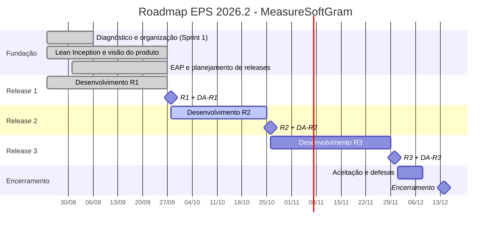

# Roadmap

As datas abaixo vêm do [cronograma da disciplina](/docs/disciplina#prazos).
Os **marcos são fixos**; o que a equipe planeja é o escopo que entra em cada um.

## Linha do tempo

## Marcos

| Marco | Data | Entrega associada | Escopo planejado |
| --- | --- | --- | --- |
| **Release 1** | 28/09/2026 | Planejamento, arquitetura, pipelines, dashboard v1, ambientes de implantação, Visão do Produto | ver ondas |
| **MD-R1** | 29/09/2026 | Memorando de Decisão individual — planejamento | Individual |
| **Release 2** | 26/10/2026 | Incremento funcional, qualidade, dashboard v2 | ver ondas |
| **MD-R2** | 27/10/2026 | Memorando de Decisão individual — qualidade | Individual |
| **Release 3** | 30/11/2026 | MVP validado pelos POs, dashboard e analytics completos | ver ondas |
| **Release Final** | 07/12/2026 | Testes de aceitação com o cliente e defesas orais | Time |
| **MD-R3** | 08/12/2026 | Memorando de Decisão individual — encerramento | Individual |

Critérios detalhados de cada release em
[Avaliação e entregas](/docs/disciplina).

## Ondas de escopo

As ondas vêm do [sequenciador da Lean Inception](/docs/lean-inception/sequenciador)
e definem os [squads da release](/docs/planejamento/squads). O MVP são as ondas 1 a 3.

| Onda | Release | Funcionalidades | Épicos/US no Zenhub |
| --- | --- | --- | --- |
| 1 | R1 → R2 | Dívida técnica · Fluxo de carregamento do frontend (correção) · LGPD (correção) · Login pelo GitLab | [MSG01 #41](https://github.com/fga-eps-mds/2026.2-MeasureSoftGram-DOC/issues/41), [MSG02 #42](https://github.com/fga-eps-mds/2026.2-MeasureSoftGram-DOC/issues/42), [MSG05 #37](https://github.com/fga-eps-mds/2026.2-MeasureSoftGram-DOC/issues/37), [US11.01 #112](https://github.com/fga-eps-mds/2026.2-MeasureSoftGram-DOC/issues/112) |
| 2 | R2 | Novos gráficos no dashboard · Importar repositórios do GitLab · Planejado × realizado sobre o equalizador · Rastreabilidade de arquivos entre métricas e medidas | [MSG21 #92](https://github.com/fga-eps-mds/2026.2-MeasureSoftGram-DOC/issues/92), [US12.01 #124](https://github.com/fga-eps-mds/2026.2-MeasureSoftGram-DOC/issues/124), [US22.01 #125](https://github.com/fga-eps-mds/2026.2-MeasureSoftGram-DOC/issues/125), [MSG23 #94](https://github.com/fga-eps-mds/2026.2-MeasureSoftGram-DOC/issues/94) |
| 3 | R3 (MVP) | Pesos por AHP · CI/CD para GitLab · Alerta de decaimento antes do merge · Característica de segurança | *a criar no Zenhub* |
| 4–5 | pós-MVP | Gráficos de pulso, relatórios de release, qualidade em uso, causa raiz, configuração via LLM | fora do semestre |

Além das ondas, cada release carrega trabalho de estabilização do
[backlog técnico](/docs/diagnostico/backlog-tecnico) (épicos MSG03 Deploys,
MSG04 DevEx, MSG05 Bugs e MSG07 Descontinuação do Grafana).

:::caution[A preencher]
Criar no Zenhub os épicos/US da onda 3 e congelar a linha de base da R3 na
planning de 26/10.
:::

## Releases minor

Versões parciais entregues ao longo das sprints, como evidência de ritmo
sustentável. Hoje as tags existentes são as `v1.0.0` de 29/09 (R1).

:::caution[A conferir]
As datas de releases minor do plano de ensino são de um semestre anterior.
Confirmar com o professor se valem para 2026.2 e registrar cada entrega aqui e no Aprender 3.
:::

| Release minor | Sprint | Data | O que foi entregue | Tags |
| --- | --- | --- | --- | --- |
| | | | | |

## Histórico de versão

| Versão | Data | Descrição | Autor | Revisor |
| --- | --- | --- | --- | --- |
| 1.0 | 10/09/2026 | Datas reais do cronograma 2026.2 e estrutura de ondas | [@MilenaFRocha](https://github.com/MilenaFRocha) |  |
| 1.1 | 21/10/2026 | Padronização: título, caixas de aviso e histórico; correções de consistência | [@MilenaFRocha](https://github.com/MilenaFRocha) |  |
