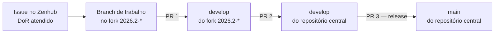
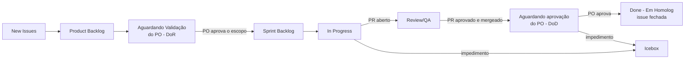

# Fluxo de trabalho

O caminho de uma mudança, da issue até a `main` do repositório central, e as
regras que valem em cada etapa: nomes de branch, commits, pull requests,
revisão e CI. Vale para todos os repositórios do ecossistema.

## Visão geral



| Etapa | De → Para | Quem abre | Quem aprova | Quando |
| --- | --- | --- | --- | --- |
| 1 | `feat/...` (fork) → `develop` (fork `2026.2-*`) | Autor da issue | 1 integrante que não é autor, de preferência de fora do squad | Ao terminar a issue |
| 2 | `develop` (fork) → `develop` (central) | Responsável do squad | 1 integrante + âncora do repositório | Ao fechar um incremento (ao menos 1× por sprint) |
| 3 | `develop` (central) → `main` (central) | Líderes da quinzena | Equipe na review e PO (homologação) | Release (minor ou major), com tag `vX.Y.Z` |

:::danger[Regras que não mudam]
- **Ninguém faz commit direto em `develop` ou `main`**, nem no fork nem no central.
- **CI verde é obrigatória** em todas as etapas: lint, build, testes e SonarCloud.
  PR com CI vermelha não é revisado.
- **O autor não aprova nem faz merge do próprio PR.**
- **A revisão não pode ser feita por IA** ([política da disciplina](/docs/disciplina#política-de-ia)).
  O autor precisa saber explicar qualquer trecho em revisão síncrona.
:::

## 1. Antes de começar

1. A issue atende o DoR do seu tipo ([US](/docs/processo/historia-de-usuario),
   task, bug ou épico: ver [Gestão do backlog](/docs/planejamento/backlog)).
2. A issue está na sprint atual, com estimativa e responsáveis.
3. Atualize o `develop` do fork antes de criar a branch:

```bash
git checkout develop
git pull origin develop
git checkout -b feat/US11.01-login-gitlab
```

## 2. Nome da branch

Formato: `<tipo>/<código-da-issue>-<descrição-curta>`, em minúsculas (exceto o
código), com hífens e sem acentos.

| Tipo | Uso | Exemplo |
| --- | --- | --- |
| `feat/` | História de usuário ou funcionalidade | `feat/US12.01-importar-repositorios-gitlab` |
| `fix/` | Correção de bug | `fix/BUG05.03-logout-invalida-token` |
| `task/` | Task técnica (infra, CI, refatoração) | `task/TASK03.04-portoes-de-ci` |
| `docs/` | Só documentação | `docs/padronizacao` |
| `hotfix/` | Correção urgente direto da `main` central (só com aval dos líderes) | `hotfix/BUG00.02-rota-publica-users` |

Branches de longa duração: `main` (estável, publicada) e `develop` (integração e
homologação), tanto no fork quanto no central.

## 3. Commits

[Conventional Commits](https://www.conventionalcommits.org/pt-br/), com a
descrição no imperativo e em português:

```
<tipo>(<escopo>): <o que o commit faz>

[corpo opcional: por quê e o que muda]

Refs #<número da issue>
Co-authored-by: Nome <email>
```

| Tipo | Uso |
| --- | --- |
| `feat` | Nova funcionalidade |
| `fix` | Correção de defeito |
| `test` | Testes novos ou ajustados |
| `refactor` | Mudança de código sem mudar comportamento |
| `docs` | Somente documentação |
| `ci` | Workflows do GitHub Actions |
| `build` | Dependências e build (`package.json`, `requirements.txt`, Docker) |
| `chore` | Manutenção que não se encaixa acima |

Exemplos: `feat(front): exibe repositórios do GitLab na importação` ·
`fix(service): invalida o token no logout`.

Boas práticas:

- Um commit por mudança lógica; não misture refatoração com funcionalidade.
- Pareamento: registre o colega com `Co-authored-by:`.
- Uso relevante de IA: registre no PR e no seu `MD_Template.md`
  ([Uso de IA na equipe](/docs/equipe/uso-de-ia)).
- Evite *squash* sem necessidade: o histórico é evidência de autoria e permite rollback
  (acordo da [reunião de 02/09](/docs/reunioes/ata-po-02-09)).

## 4. Pull request

Use o [template de PR](/docs/processo#pull-request). Um bom PR:

| Precisa ter | Por quê |
| --- | --- |
| Título no padrão de commit, com o código da issue: `feat(front): [US11.01] login com GitLab` | Rastreabilidade no Zenhub e no histórico |
| `Refs <repo>#<n>` ligando a issue (`Closes` só para tasks e bugs sem validação do PO) | A issue só fecha depois da aprovação do PO ([seção 7](#7-a-issue-no-quadro-do-zenhub)) |
| O que muda e **por quê**, em 2–5 frases | O revisor entende a intenção antes de ler o código |
| Passo a passo de **como testar** | Qualquer pessoa reproduz sem perguntar ao autor |
| Evidências (print, GIF, log, saída de teste) | Prova que funciona; vira evidência da release |
| Impacto na qualidade (quality gate, testes adicionados) | A qualidade não piora sem alguém perceber |
| Tamanho revisável (idealmente < 400 linhas alteradas) | PR grande é aprovado sem ser lido |

### Revisão

O revisor:

1. Lê a issue e os critérios de aceitação antes do código.
2. Roda localmente ou na homologação quando houver interface ou comportamento novo.
3. Comenta com sugestão concreta; usa **Request changes** só para o que bloqueia.
4. Confere o checklist do revisor no template.

Prazo combinado: primeira revisão em até **2 dias úteis**. PR parado há mais
tempo vai para a daily como bloqueio.

## 5. Integração no central e release

- **Etapa 2 (fork → central):** o responsável do squad abre o PR do `develop` do
  fork para o `develop` central, lista as issues incluídas e confere se a CI do
  central também passa. A âncora do repositório revisa.
- **Etapa 3 (release):** na review, os líderes da quinzena abrem o PR de
  `develop` para `main` no central, com o resumo das issues da release. Depois do
  merge, criam a tag `vX.Y.Z` (SemVer) e registram a entrega na página da
  [release](/docs/releases/release-2).

## 6. Depois do merge

- Apague a branch de trabalho.
- Mova a issue para **Aguardando aprovação do PO (DoD)** e avise na issue, com o
  link da homologação e o passo a passo de validação.
- **Não feche a issue no merge** quando ela depende de validação do PO: use
  `Refs #n` no PR em vez de `Closes #n`. Só feche quando o PO aprovar.

## 7. A issue no quadro do Zenhub



| Pipeline | Entra quando | Quem move |
| --- | --- | --- |
| New Issues | A issue é criada | Autor |
| Escopo Técnico | Demanda técnica (ambiente, arquitetura, deploy, correção) ainda não priorizada | Autor |
| Product Backlog | A issue foi refinada, estimada e priorizada | Líderes da quinzena |
| Aguardando Validação do PO (DoR) | US, épico ou task com impacto funcional precisa do OK do PO **antes** de começar | Responsável pela issue |
| Sprint Backlog | DoR atendido e issue planejada na sprint | Líderes da quinzena (planning) |
| In Progress | Alguém começou a trabalhar (branch criada) | Responsável pela issue |
| Review/QA | PR aberto, aguardando revisão e testes | Autor do PR |
| Aguardando aprovação do PO (DoD) | PR revisado e mergeado; falta o PO validar os critérios de aceitação na homologação | Autor do PR |
| Done [Em Homolog] | **PO aprovou.** A issue é movida para cá e **fechada** | Responsável pela issue |
| Icebox | Há um **impedimento** (o PO reprovou, dependência externa, bloqueio técnico) e a issue não continua nesta sprint | Responsável, avisando na daily |

Regras:

- **A issue só é fechada depois da aprovação do PO.** Fechada = feita
  ([decisão D2](/docs/planejamento/decisoes#d2-critério-de-feito-e-níveis-pontuados)),
  então fechar antes conta ponto que o PO ainda não aceitou.
- Tasks e bugs **sem impacto funcional** não passam pelo PO: depois do merge vão
  direto para **Done [Em Homolog]** e são fechadas.
- Ao mandar para **Icebox**, comente na issue o impedimento e o que destrava, e
  registre como bloqueio na daily. Se o PO reprovou, a issue volta para
  **Sprint Backlog** quando o ajuste entrar no planejamento.
- Feche a issue primeiro e mova depois: mover uma issue já fechada para outra
  pipeline faz o Zenhub reabri-la.

## Histórico de versão

| Versão | Data | Descrição | Autor | Revisor |
| --- | --- | --- | --- | --- |
| 1.0 | 21/10/2026 | Criação: fluxo fork → develop → develop central → main, padrões de branch, commit, PR e revisão | [@MilenaFRocha](https://github.com/MilenaFRocha) |  |
| 1.1 | 22/10/2026 | Quadro do Zenhub: aprovação do PO antes de fechar, Done e Icebox para impedimentos | [@MilenaFRocha](https://github.com/MilenaFRocha) |  |
