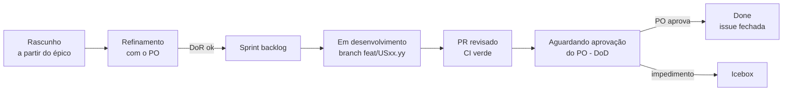

# Como escrever uma história de usuário

Modelo para criar uma US, os critérios para avaliar se ela está bem escrita e as
listas de **DoR** (pronta para entrar na sprint) e **DoD** (pronta para fechar).
O mesmo conteúdo está no template de issue
[`historia-de-usuario.md`](https://github.com/fga-eps-mds/2026.2-MeasureSoftGram-DOC/blob/main/.github/ISSUE_TEMPLATE/historia-de-usuario.md),
que aparece ao criar uma issue no GitHub. Os acordos completos estão em
[Gestão do backlog](/docs/planejamento/backlog).

## Ciclo de vida da US



## Modelo

Título: `[USXX.YY] <verbo> <o quê>` — `XX` é o número do épico pai (`[MSGXX]`) e
`YY` o sequencial da US dentro dele. Ex.: `[US12.01] Importar repositórios do GitLab`.

```markdown
## 1. História
**Como** [persona: Valéria, Helena, Miguel…]
**Quero** [ação, sem termos técnicos]
**Para que** [benefício para a persona]

## 2. Contexto
Épico: [MSGXX] · Onda do sequenciador: [1/2/3] · Protótipo: [link do frame no Figma ou "sem interface"]

## 3. Critérios de aceitação (BDD, validados com o PO)
### Cenário 1: [caminho principal]
- **Dado** que [estado inicial]
- **Quando** [ação do usuário]
- **Então** [resultado observável]

### Cenário 2: [exceção ou alternativa]
- **Dado** que […]
- **Quando** […]
- **Então** […]

## 4. Critérios técnicos
- Repositórios afetados: [Front, Service, Core…]
- Contratos/endpoints: [ex.: GET /api/v1/…]
- Restrições e dependências: [outra US, versão de biblioteca…]

## 5. Como validar
Passo a passo que o PO e o revisor seguem na homologação.
```

## Critérios de avaliação de uma boa US

Use na revisão do backlog e no refinamento. Se algum item falhar, a US volta para o
autor antes de ir ao PO.

| Critério (INVEST) | Pergunta | Sinal de problema |
| --- | --- | --- |
| **Independente** | Dá para entregar sem esperar outra US da mesma sprint? | "Depende da US12.02 ficar pronta antes" |
| **Negociável** | O texto descreve a necessidade, não a solução? | Nome de tabela, componente ou endpoint na história |
| **Valiosa** | A persona percebe a diferença quando a US é entregue? | US que só refatora código (isso é task) |
| **Estimável** | O time consegue estimar no Planning Poker? | Estimativas muito diferentes entre as pessoas |
| **Pequena** | Cabe em uma sprint (semanal) com folga? | Mais de 8 pontos: quebrar |
| **Testável** | Cada cenário tem resultado observável? | "Deve ser rápido", "deve ser intuitivo" |

Também verificar:

- Os critérios de aceitação usam **Dado / Quando / Então** e cobrem pelo menos um
  cenário de exceção.
- Critério de aceitação (o **quê**, negócio) separado de critério técnico (o **como**).
- Correção de defeito existente **não** é US: abra um bug
  (diretriz do PO, [ata de 23/09](/docs/reunioes/ata-po-23-09)).

## DoR — pronta para entrar na sprint

- [ ] História no formato **Como / Quero / Para que**, com persona do produto.
- [ ] Passou nos critérios de avaliação (INVEST).
- [ ] Critérios de aceitação em BDD, com cenário de exceção.
- [ ] Critérios técnicos mapeados (repositórios, contratos, dependências).
- [ ] Protótipo de alta fidelidade no Figma anexado (se tiver interface).
- [ ] **Cenários e escopo validados com o PO** (registrar na issue ou na ata).
- [ ] Estimativa por Planning Poker (≤ 8 pontos).
- [ ] Responsáveis, épico pai, labels de repositório e sprint configurados no Zenhub.

## DoD — pronta para fechar

- [ ] Todos os cenários BDD funcionando e demonstrados.
- [ ] Testes automatizados da mudança (unitários e/ou integração) passando.
- [ ] Quality gate do SonarCloud aprovado, sem problemas novos de severidade alta.
- [ ] PR seguindo o [fluxo de trabalho](/docs/processo/fluxo-de-trabalho): revisado,
  aprovado por outra pessoa e com CI verde.
- [ ] Código no `develop` do repositório central (homologação).
- [ ] Interface conforme o protótipo do Figma (se aplicável).
- [ ] **Validada pelo PO na homologação.**
- [ ] Documentação afetada atualizada.
- [ ] Issue movida para **Done [Em Homolog]** e fechada só depois da aprovação do PO ([quadro do Zenhub](/docs/processo/fluxo-de-trabalho#7-a-issue-no-quadro-do-zenhub)).

## Histórico de versão

| Versão | Data | Descrição | Autor | Revisor |
| --- | --- | --- | --- | --- |
| 1.0 | 21/10/2026 | Criação: modelo de US, critérios INVEST, DoR e DoD | [@MilenaFRocha](https://github.com/MilenaFRocha) |  |
| 1.1 | 22/10/2026 | Ciclo de vida com aprovação do PO, Done e Icebox | [@MilenaFRocha](https://github.com/MilenaFRocha) |  |
