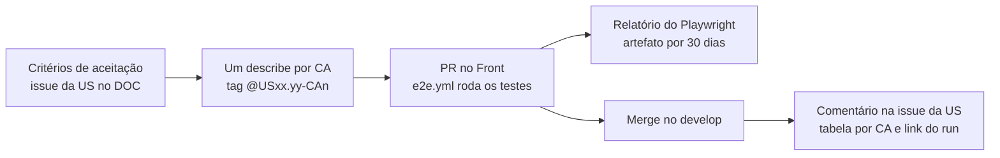

# Validação por testes E2E

Desde 09/11/2026, a aceitação de uma US com interface no Front é feita por **teste E2E, um cenário por critério de aceitação**, e não mais por formulário ([ata de 09/11](/docs/reunioes/reunioes-time/ata-reuniao-time-09-11)). Esta página diz como o teste funciona, como escrever o da sua US e onde o PO e o revisor encontram a evidência.

## O que foi decidido

| Decisão | Origem |
| --- | --- |
| Cada critério de aceitação vira um cenário E2E, e o resultado vai para a issue da US | [Ata de 09/11](/docs/reunioes/reunioes-time/ata-reuniao-time-09-11), seção 6 |
| O que ainda não tem teste é validado manualmente, com print como evidência | Ata de 09/11, seção 1 |
| Quem desenvolveu não valida: os cards registram quem valida cada item | Ata de 09/11, seção 1 |
| Antes de abrir o PR, o teste roda 3 vezes localmente, para pegar instabilidade | Ata de 09/11, seção 6 |
| A Luiza escreve o E2E das US que já tinham código no Front; nas US novas, quem implementa escreve o da sua | Ata de 09/11, seção 2, e plano de execução dos E2E (10/11) |

## Como funciona

O teste abre o Front de verdade num Chromium, com uma sessão simulada, e responde à API com JSON fixo. Por isso não depende do Service, da VM nem de login no GitHub ou no GitLab, e dá sempre o mesmo resultado.

| Peça | Onde fica no Front | O que faz |
| --- | --- | --- |
| Playwright (só Chromium) | `playwright.config.ts`, `e2e/**/*.e2e.ts` | `pnpm e2e` faz o build, sobe o `next start` e roda os testes |
| API simulada | `e2e/support/api.ts` | Responde a cada `/api/v1/...` pelo caminho exato. Rota sem resposta faz o teste falhar, para nada passar em silêncio |
| Sessão simulada | `e2e/support/session.ts` | O usuário já entra logado, sem OAuth |
| Fixtures | `e2e/fixtures/common.ts` e `e2e/fixtures/<pagina>/` | Respostas no formato do Service, uma por cenário: com dados, vazio, erro e casos de borda |
| Um `describe` por critério | `e2e/usXX-YY-<pagina>.e2e.ts` | O título começa com `@USxx.yy-CAn`; `pnpm e2e --grep @USxx.yy` roda a US inteira |
| CI | `.github/workflows/e2e.yml` | Roda em todo PR e push para `develop` e `main` e guarda o relatório como artefato |
| Resultado na issue | `scripts/e2e-acceptance-comment.mjs` e `e2e/acceptance-issues.json` | No push para `develop`, atualiza um comentário na issue de cada US |

## Como cada critério é testado

Os gráficos são desenhados em canvas (ECharts), então nem tudo dá para ler no navegador. Cada critério cai em uma destas classes:

| Classe | Quando | Como aparece na issue |
| --- | --- | --- |
| **E2E** | O resultado está na tela, em texto, tabela, botão ou atributo | Passou ou falhou |
| **E2E pelo CSV** | O conteúdo está num gráfico, mas a página exporta CSV com os mesmos dados | Passou ou falhou |
| **Snapshot** | Só o desenho mostra o critério (cores, eixos, curvas); a imagem de referência é gerada no CI | Passou ou falhou |
| **Manual** | Tooltip, hover ou clique num ponto do gráfico (`test.skip`) | Lista "Verificação manual": quem valida anexa o print |
| **Bug conhecido** | O critério não é atendido hoje e há bug aberto (`test.fixme`) | "Não atendido (bug conhecido)" e lista própria; volta a ser teste depois da correção |
| **Fora do Front** | Regra do Service, do Core ou da CLI (cálculo, permissão, persistência) | Não entra no E2E do Front |

## Como escrever o E2E da sua US

No Front, a skill [`msg-e2e-por-criterio`](https://github.com/fga-eps-mds/2026.2-MeasureSoftGram-Front/blob/develop/.claude/skills/msg-e2e-por-criterio/SKILL.md) faz o passo a passo com o Claude Code: peça "faz o e2e da USxx.yy" com o repositório aberto. Sem a skill, o caminho é o mesmo:

1. Leia os critérios e os comentários do PO na issue da US. Sem critério escrito não há teste: a US volta para o refinamento.
2. Ache a página, o hook e os endpoints que ela pede, e veja o que está no DOM e o que está em canvas.
3. Classifique cada critério (tabela acima) e confirme a classificação com quem valida a US.
4. Grave as fixtures em `e2e/fixtures/<pagina>/`, com dados de exemplo (anonimize respostas copiadas da homologação).
5. Escreva um `describe` por critério, com a tag `@USxx.yy-CAn`. A US21.03 ([`us21-03-distribuicao.e2e.ts`](https://github.com/fga-eps-mds/2026.2-MeasureSoftGram-Front/blob/develop/e2e/us21-03-distribuicao.e2e.ts)) é o modelo.
6. Rode com Node 20, a mesma versão do CI: `pnpm e2e --grep @USxx.yy --repeat-each=3`. As 3 execuções precisam passar.
7. Se a US não estiver em `e2e/acceptance-issues.json`, acrescente-a dentro de `issues`, com o número da issue no DOC.
8. Abra o PR com a tabela "critério → como foi testado".

## Onde fica a evidência

- **Na issue da US:** depois do merge no `develop`, o CI mantém um comentário com a tabela por critério (testes, passaram, instáveis, falharam, bug conhecido, manuais), as listas de verificação manual e de bugs conhecidos, o link do run e o histórico dos últimos 10 runs. É esse comentário que o PO e o revisor conferem.
- **No relatório do Playwright:** em cada run do workflow [Testes E2E](https://github.com/fga-eps-mds/2026.2-MeasureSoftGram-Front/actions/workflows/e2e.yml), em *Artifacts*, o `playwright-report` fica 30 dias. Para abrir: descompacte e rode `npx playwright show-report <pasta>`.

O comentário usa o secret `DOC_ISSUES_TOKEN` do Front, um token pessoal da Luiza com permissão só de issues no DOC. Os comentários saem no nome dela; se o token expirar, eles param, sem quebrar o CI.

## Situação das US

| US | Issue | E2E no Front |
| --- | --- | --- |
| US21.03 Distribuição Estatística | [DOC#128](https://github.com/fga-eps-mds/2026.2-MeasureSoftGram-DOC/issues/128) | [Front#105](https://github.com/fga-eps-mds/2026.2-MeasureSoftGram-Front/pull/105), mergeado |
| US21.01 Metamodelo | [DOC#126](https://github.com/fga-eps-mds/2026.2-MeasureSoftGram-DOC/issues/126) | [Front#120](https://github.com/fga-eps-mds/2026.2-MeasureSoftGram-Front/pull/120), mergeado |
| US21.02 Análise por Entidade | [DOC#127](https://github.com/fga-eps-mds/2026.2-MeasureSoftGram-DOC/issues/127) | [Front#122](https://github.com/fga-eps-mds/2026.2-MeasureSoftGram-Front/pull/122), mergeado |
| US21.04 Relações e Correlações | [DOC#129](https://github.com/fga-eps-mds/2026.2-MeasureSoftGram-DOC/issues/129) | [Front#126](https://github.com/fga-eps-mds/2026.2-MeasureSoftGram-Front/pull/126), mergeado |
| US07.01 Dashboards sem o Grafana | [DOC#131](https://github.com/fga-eps-mds/2026.2-MeasureSoftGram-DOC/issues/131) | [Front#128](https://github.com/fga-eps-mds/2026.2-MeasureSoftGram-Front/pull/128), mergeado |
| US06.01 Pulso do TSQMI por release | [DOC#67](https://github.com/fga-eps-mds/2026.2-MeasureSoftGram-DOC/issues/67) | [Front#125](https://github.com/fga-eps-mds/2026.2-MeasureSoftGram-Front/pull/125), mergeado |
| US22.01 Equalizador planejado × realizado | [DOC#125](https://github.com/fga-eps-mds/2026.2-MeasureSoftGram-DOC/issues/125) | [Front#121](https://github.com/fga-eps-mds/2026.2-MeasureSoftGram-Front/pull/121), mergeado |
| US01.02 Dívida técnica no Front | [DOC#77](https://github.com/fga-eps-mds/2026.2-MeasureSoftGram-DOC/issues/77) | [Front#123](https://github.com/fga-eps-mds/2026.2-MeasureSoftGram-Front/pull/123), mergeado |
| US12.01 Importar projetos do GitLab | [DOC#124](https://github.com/fga-eps-mds/2026.2-MeasureSoftGram-DOC/issues/124) | [Front#127](https://github.com/fga-eps-mds/2026.2-MeasureSoftGram-Front/pull/127), mergeado |
| US11.01 Login com GitLab | [DOC#112](https://github.com/fga-eps-mds/2026.2-MeasureSoftGram-DOC/issues/112) | [Front#124](https://github.com/fga-eps-mds/2026.2-MeasureSoftGram-Front/pull/124), mergeado |
| US11.03 Termos do GitLab | [DOC#114](https://github.com/fga-eps-mds/2026.2-MeasureSoftGram-DOC/issues/114) | [Front#117](https://github.com/fga-eps-mds/2026.2-MeasureSoftGram-Front/pull/117), em revisão |
| US14.01 Segurança | [DOC#132](https://github.com/fga-eps-mds/2026.2-MeasureSoftGram-DOC/issues/132) | Sem critérios de aceitação ainda |
| US30.01, US30.02 e US30.03 Faixas configuráveis | [DOC#178](https://github.com/fga-eps-mds/2026.2-MeasureSoftGram-DOC/issues/178) a [#180](https://github.com/fga-eps-mds/2026.2-MeasureSoftGram-DOC/issues/180) | Entra com a implementação |

A US06.02 (#68) e a US06.03 (#69) foram fechadas por virarem os cenários 4 a 7 da US06.01, e estão cobertas pelo E2E dela.

:::caution[A preencher]
- Se o E2E de uma US nova vai no mesmo PR da implementação ou num PR separado: decisão da equipe, registrada nesta página (ata de 09/11, seção 6).
- Tirar a US06.02 e a US06.03 de `e2e/acceptance-issues.json`, porque não são histórias: Luiza, próximo PR de E2E.
:::

## Evidências

- [Ata da reunião do time de 09/11](/docs/reunioes/reunioes-time/ata-reuniao-time-09-11), seções 1, 2 e 6
- Infraestrutura do Playwright: [Front#104](https://github.com/fga-eps-mds/2026.2-MeasureSoftGram-Front/pull/104)
- Resultado por critério na issue da US: [Front#109](https://github.com/fga-eps-mds/2026.2-MeasureSoftGram-Front/pull/109) e bug conhecido separado de manual: [Front#132](https://github.com/fga-eps-mds/2026.2-MeasureSoftGram-Front/pull/132)
- Skill para escrever o E2E de uma US: [Front#115](https://github.com/fga-eps-mds/2026.2-MeasureSoftGram-Front/pull/115)
- Exemplo de comentário na issue: [DOC#128](https://github.com/fga-eps-mds/2026.2-MeasureSoftGram-DOC/issues/128)

## Histórico de versão

| Versão | Data | Descrição | Autor | Revisor |
| --- | --- | --- | --- | --- |
| 1.0 | 11/11/2026 | Criação: decisões, funcionamento, classes de critério, passo a passo, evidência e situação das US | [@LuizaMaluf](https://github.com/LuizaMaluf) |  |
